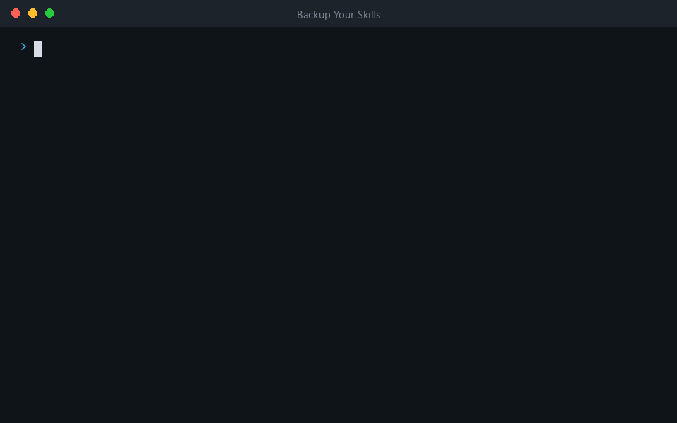

[](https://github.com/anandsundaramoorthysa/backup-your-skills/actions/workflows/ci.yml)
[](LICENSE)
[](#installation)
[](https://www.python.org/)
[](https://agentskills.io/specification)
[](#contributing)

# Backup Your Skills

> Never lose your agent skills again. A free, **open-source** skill that backs up your user-level,
> project-level and custom skills to a GitHub repo, keeps it up to date, and reinstalls them on
> any machine.

You build up skills over months: ones you installed, ones you wrote, ones that live inside a
single project. Then you change laptops, reinstall your OS, or delete a folder, and they are
gone. Backup Your Skills puts them all in a Git repo you control, and brings them back whenever
you ask. You just talk to your agent; it does the work.



<sub>Demo: the script output is from a real run on sample skills; the chat lines are illustrative.</sub>

## Table of Contents

- [About Project](#about-project)
- [Why Backup Your Skills](#why-backup-your-skills)
- [Features](#features)
- [Installation](#installation)
- [Usage](#usage)
- [How It Works](#how-it-works)
- [Backup Repo Layout](#backup-repo-layout)
- [Safety and Privacy](#safety-and-privacy)
- [Project Structure](#project-structure)
- [Tech Stack](#tech-stack)
- [Testing](#testing)
- [Contributing](#contributing)
- [Roadmap](#roadmap)
- [License](#license)
- [Contact Me](#contact-me)
- [Acknowledge](#acknowledge)

## About Project

Skills are plain folders with a `SKILL.md` inside, so they are easy to copy but easy to forget.
Backup Your Skills is itself a skill: install it once, then say "back up my skills" and your
agent will:

1. Find your user-level skills and the project-level skills in the folders you point it at.
2. Ask which ones you want to include, custom skills you wrote among them.
3. Create (or reuse) a GitHub repo, scan for secrets, commit and push.

Months later, "sync my new skills" copies only what is new or changed. On a new machine,
"restore my skills" puts them back. There is no service, account or server: it is a small Python
script, Git, and your own GitHub repo.

## Why Backup Your Skills

| Capability | Copy folders by hand | Dotfiles repo | Backup Your Skills |
|---|---|---|---|
| Picks user and project skills for you | No | No | **Yes** |
| You choose what goes in | Manual | Manual | **Yes** |
| Updates only new or changed skills | No | Via Git | **Yes** |
| Secret scan before pushing | No | No | **Yes** |
| Remembers installed plugins to reinstall | No | No | **Yes** |
| Guided restore to a new machine | No | No | **Yes** |
| Needs extra software | No | Git | Python + Git |

## Features

- **User and project skills:** backs up `~/.claude/skills` and any project's `.claude/skills`.
  Point it at specific projects or let it search a folder tree.
- **You choose:** it lists everything it found and asks what to include, including the custom
  skills you wrote yourself.
- **Incremental updates:** each skill is hashed. Re-running only copies new or changed skills,
  and `status` shows what changed before you commit anything.
- **Guided restore:** pick all or some skills. Project skills go to the project folder you name
  on the new machine.
- **Never destroys data:** restore skips skills that already exist. `--overwrite` keeps the old
  copy as `<name>.bak`. Deleted skills are only removed from the backup with `--prune`.
- **Secret scan:** blocks the backup when it sees private keys, cloud and GitHub tokens, API
  keys or `password = "..."` style values. You decide what to do; nothing is silently uploaded.
- **Plugins handled sensibly:** marketplace plugin skills are not copied (they are re-downloadable
  and managed by the plugin system). Their names are saved so you can reinstall them.
- **Cross-platform, zero dependencies:** one standard-library Python script for Windows, macOS
  and Linux.
- **Agent-ready design:** Claude Code is supported today; other agents are one entry in a table.

## Installation

Needs **Python 3.9+** and **Git**. The [GitHub CLI](https://cli.github.com/) is optional; it is
used to create the repo for you.

```bash
git clone https://github.com/anandsundaramoorthysa/backup-your-skills
cp -r backup-your-skills/skills/backup-your-skills ~/.claude/skills/
```

Windows PowerShell:

```powershell
git clone https://github.com/anandsundaramoorthysa/backup-your-skills
Copy-Item -Recurse backup-your-skills\skills\backup-your-skills $HOME\.claude\skills\
```

Restart your agent session so the skill loads.

## Usage

Talk to your agent:

| Say | What happens |
|---|---|
| "Back up my skills" | Finds skills, asks what to include and where, sets up the repo, pushes |
| "Sync my new skills to my backup" | Shows what is new or changed, backs up only those |
| "Restore my skills from `<repo url>`" | Clones the repo, lets you pick, installs them |

Or run the script yourself:

```bash
S=skills/backup-your-skills/scripts/skillvault.py

python $S discover --cwd                                          # what skills exist
python $S backup  --repo ~/skills-backup --select all --cwd       # copy into the backup folder
python $S status  --repo ~/skills-backup --cwd                    # new / changed / unchanged
python $S restore --repo ~/skills-backup --select all --project-dir ~/code/app
```

| Flag | Meaning |
|---|---|
| `--project DIR` | Include a project's skills (repeatable) |
| `--scan-root DIR` | Search a folder tree for projects that have skills |
| `--cwd` | Include the current directory as a project |
| `--select ID...` | Skill ids like `user/my-skill` or `project/app/deploy`, or `all` |
| `--prune` | Remove skills you deleted locally from the backup |
| `--overwrite` | On restore, replace existing skills (old copy kept as `.bak`) |
| `--allow-secrets` | Back up even though the secret scan found something. Use with care |
| `--agent NAME` | Which agent's paths to use (default `claude`) |

The script prints JSON, so agents (and scripts) can read the result. Your skills home defaults to
`~/.claude`; set `CLAUDE_CONFIG_DIR` to change it.

## How It Works

```
   your machine                                         GitHub (your repo)
  +-----------------------------+
  | ~/.claude/skills/*          |--+
  | <project>/.claude/skills/*  |--+--> skillvault.py --> backup folder --> git push --> origin
  +-----------------------------+  |      discover          skills/...
                                   |      hash + diff       manifest.json
                                   |      secret scan
  restore  <-----------------------+------ git clone/pull <-----------------------------+
```

Each skill gets an id (`user/<name>` or `project/<project>/<name>`) and a content hash stored in
`manifest.json`. A backup copies only skills whose hash changed. `SKILL.md` tells the agent the
conversation to have (what to ask, when to stop); `skillvault.py` does the file work. Git and `gh`
handle the repo.

## Backup Repo Layout

```
skills/
  user/<name>/                  user-level skills
  project/<project>/<name>/     project-level skills
manifest.json                   hashes, dates, plugin names to reinstall
```

## Safety and Privacy

- **Public or private is your call.** The skill asks every time and never pushes before you
  answer. If in doubt, choose private.
- Skills can contain personal paths, tokens or API keys. The built-in scan is a safety net, not
  a guarantee: review before making a backup repo public.
- Credential files (`.env`, `*.pem`, `*.key`, `id_rsa*`, `.npmrc`, `.netrc` and similar) are never copied. The backup output lists which ones were left out. `.env.example` templates are kept.
- Nothing is sent anywhere except the Git remote you choose. There is no telemetry.
- Report security problems privately, see [SECURITY.md](SECURITY.md).

## Project Structure

```
backup-your-skills/
  skills/backup-your-skills/
    SKILL.md                    the skill: what the agent asks and does
    scripts/skillvault.py       discover, backup, status, restore (stdlib only)
  tests/test_skillvault.py      backup -> change -> restore round trip
  assets/                       demo.gif and social-preview.png
  .github/                      CI, issue forms, pull request template
  CHANGELOG.md  CONTRIBUTING.md  CODE_OF_CONDUCT.md  SECURITY.md  LICENSE
```

## Tech Stack

| Layer | Choice |
|---|---|
| Skill format | [Agent Skills](https://agentskills.io/specification) (`SKILL.md`) |
| Engine | Python 3.9+, standard library only |
| Storage | Plain folders + `manifest.json` in a Git repo |
| Hosting | GitHub (via `git` and optional `gh`) |
| CI | GitHub Actions on Windows, macOS and Linux |

## Testing

```bash
python tests/test_skillvault.py
```

The test runs in temporary folders, so it never touches your real skills.

## Contributing

Contributions are welcome: bug fixes, support for another agent, better secret patterns, or docs.

### Guidelines

- **Discuss first:** for anything non-trivial, open an
  [issue](https://github.com/anandsundaramoorthysa/backup-your-skills/issues) before coding.
- **No dependencies:** the script must run on a bare Python 3.9+ install.
- **Never delete user data silently:** overwrites and removals need an explicit flag.
- **Verify before a PR:** `python tests/test_skillvault.py` must pass.

### Steps

1. **Fork** the [repository](https://github.com/anandsundaramoorthysa/backup-your-skills).
2. Create a branch: `git checkout -b feature/your-feature`.
3. Make your changes and run the test.
4. **Commit** with a clear message.
5. **Open a pull request** describing your change and linking any related issue.

See [CONTRIBUTING.md](CONTRIBUTING.md) for how to add a new agent.
[View Open Issues](https://github.com/anandsundaramoorthysa/backup-your-skills/issues)

## Roadmap

- [x] User-level and project-level skill backup (Claude Code)
- [x] Incremental updates with `status`
- [x] Guided restore, `.bak` safety, secret scan
- [x] Plugin list saved for reinstall
- [x] CI on Windows, macOS and Linux
- [ ] Support for more agents (needs verified skill paths for each)
- [ ] Optional encrypted backups for private skills
- [ ] Scheduled automatic backups
- [ ] Publish to skill directories

## License

This project is released under the **MIT License**. You are free to use, modify, and distribute
it under the terms of this license. See the [LICENSE](LICENSE) file for the full text.

## Contact Me

If you have any questions, feedback, or suggestions, feel free to reach out:

- **Anand Sundaramoorthy** - [sanand03072005@gmail.com](mailto:sanand03072005@gmail.com?subject=About%20Backup%20Your%20Skills)
- **GitHub:** [@anandsundaramoorthysa](https://github.com/anandsundaramoorthysa)
- **LinkedIn:** [anandsundaramoorthysa](https://www.linkedin.com/in/anandsundaramoorthysa)
- **Website:** [anandsundaramoorthy.com](https://anandsundaramoorthy.com)

## Acknowledge

Built on these open projects and ideas:

- [Agent Skills](https://agentskills.io/specification) - the open `SKILL.md` format
- [Claude Code](https://code.claude.com/docs/en/skills) - the skills system this was first built for
- [Git](https://git-scm.com/) and the [GitHub CLI](https://cli.github.com/) - storage and publishing
- [Contributor Covenant](https://www.contributor-covenant.org) - the code of conduct
- [Keep a Changelog](https://keepachangelog.com) - the changelog format

Thanks to the open-source community for the tools and guidance that made this possible.
